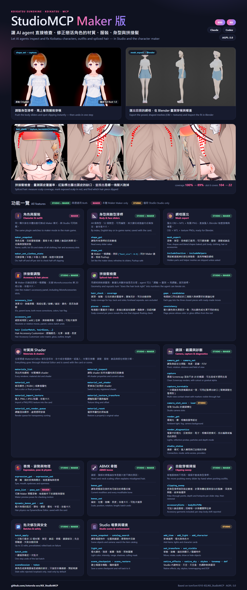

# StudioMCP Maker 版（Koikatsu Sunshine／Koikatsu）

讓 Claude、Codex 等 AI agent 直接操作 **Koikatsu Sunshine（KKS）與 Koikatsu（KK）的 Studio 與本體角色 Maker**：查看並修改角色材質、
shader、貼圖、服裝穿脫、身型滑桿，調整拼接髮並量測頭皮覆蓋，自動掃描服裝穿模，環繞截圖比較，以及把角色網格匯出到 Blender。
特別適合**移植模型／服裝**與**拼接髮**時即時檢查問題。



本專案改編自 [tomTom1010-IEE/KK_StudioMCP](https://github.com/tomTom1010-IEE/KK_StudioMCP)（原版只支援 Studio），
沿用 AGPL-3.0 授權。[English summary](#english-summary)

## 懶人安裝（3 步）

1. 到 [Releases](https://github.com/Jotorola-scv/KK_StudioMCP/releases) 下載對應遊戲的安裝包：KKS 用 `StudioMCP-Maker-KKS-*.zip`，KK 用 `StudioMCP-Maker-KK-*.zip`。解壓到任何地方（解壓到遊戲資料夾裡最省事）。
2. 雙擊 **`Install.bat`**。如果找不到遊戲，把遊戲資料夾（有 `CharaStudio.exe` 的那個）拖進視窗按 Enter。
3. 重新啟動遊戲和 AI 工具。

安裝程式會自動完成：

- 放入遊戲外掛 `BepInEx/plugins/StudioMCP`，被取代的舊檔案會備份。
- 放入 MCP 伺服器 `StudioMCP-Host/`，由微軟簽章的 `dotnet.exe` 執行。需要 **.NET 8 Runtime**，沒有的話 `Install.bat` 會自動用 winget 安裝微軟官方版本。
- 開啟寫入權限（只要唯讀：用命令列執行 `Install.bat --read-only`）。
- 註冊兩個 MCP 伺服器到電腦上已安裝的 **Claude Code、Claude Desktop、Codex**，並先備份原設定檔：

  | | KKS | KK |
  |---|---|---|
  | Studio | `studiomcp`（埠 8846） | `kkstudiomcp`（埠 8847） |
  | 本體 Maker | `kksmaker`（埠 8848） | `kkmaker`（埠 8849） |
- 其他 MCP 工具可參考 `StudioMCP-Host/mcp-config-example.json` 手動設定。

移除：雙擊 `Uninstall.bat`（截圖、存檔點與備份會保留在 `UserData/StudioMCP`）。

**需求**：KKS 或 KK + BepInEx + Modding API（KKSAPI／KKAPI，HF Patch 已內含）。材質功能需要 Material Editor，截圖需要 Screencap。
KK 與 KKS、Studio 與本體都可以同時開，各自使用不同的埠與 MCP 名稱，互不干擾。

**防毒軟體**：安裝包不含任何自製的 exe，只有 BepInEx 外掛 DLL、由 `dotnet.exe` 執行的 MCP 伺服器 DLL 和兩個 bat 檔，
避免被防毒的啟發式掃描誤擋。若仍被攔截，請把遊戲資料夾裡的 `StudioMCP-Host` 加入防毒信任清單。

## 能做什麼

### 角色檢查（Studio 與 Maker 都能用）

| 工具 | 功能 |
|---|---|
| `shape_get` | 讀取 44 個身型滑桿（或臉型）：編號、英文鍵名、遊戲內名稱、目前數值 |
| `shape_set` | 像 Maker 一樣調整身型／臉型，例如 `{"bust_size": 0.9, "waist_position": 0.4}`；會存進卡片或場景 |
| `mesh_export` | 把角色目前的網格（姿勢、身型、表情都已套用）匯出成 OBJ + MTL + 貼圖 PNG，可直接匯入 Blender 檢查穿模；可只匯出身體、服裝、頭髮或飾品 |
| `materials_list` | 列出所有網格、材質槽、shader，並分類為身體／頭髮／服裝／飾品與部位格號 |
| `material_inspect` | 讀取材質的所有 shader 屬性與目前數值 |
| `material_set` | 修改顏色（RGBA）或數值屬性 |
| `material_set_shader` | 更換 shader |
| `material_import_texture` | 匯入 PNG／JPEG 貼圖，會存進卡片或場景 |
| `material_texture_transform` | 調整貼圖平鋪與偏移 |
| `material_set_render_queue` | 調整渲染順序（處理透明穿插） |
| `material_reset` | 還原某屬性的原始值 |
| `camera_get` / `camera_set` | 讀取／設定鏡頭 |
| `capture` | 渲染截圖（不含 UI），可選去背模式 |
| `capture_turntable` | 一次從多個角度環繞截圖並拼成一張；可用紅點標出 `hair_check` 找到的缺口（隔著頭髮也看得到） |
| `batch_apply` / `batch_undo` | 一次執行多個修改（材質、身型、飾品、ABMX、鏡頭），可一鍵復原 |
| `render_get` / `render_diagnostics` | 唯讀的燈光、反射探針、相機深度資訊 |

材質修改都透過 Material Editor 保存。在 Maker 裡 `objectId` 一律填 `0`；在 Studio 裡填角色或物件的 ID。

### 拼接髮與移植檢查（Studio 與 Maker 都能用）

| 工具 | 功能 |
|---|---|
| `accessory_list` | 列出飾品：清單 ID 與名稱、掛載骨骼、兩組微調（位置／旋轉／縮放）、顏色、是否為頭髮，以及 Hair Accessory Customizer 的跟隨髮色、光澤、描邊、長度 |
| `accessory_set` | 像 Maker 的飾品面板一樣調整：位置／旋轉／縮放（絕對值或 `add` 相對值）、換掛載骨骼、改顏色、Hair Accessory Customizer 設定；存進卡片，支援 MoreAccessories 第 20 格以後 |
| `hair_check` | 量測拼接髮：頭頂／後腦／左右的頭皮覆蓋率（瀏海另計，耳朵排除）；每個缺口列出三個最近的髮片與建議位移；每個髮片的覆蓋點數（`covers`，前後比較可找出跑掉的髮片）與浮起判斷；髮片顏色與光澤是否一致 |
| `clipping_sweep` | 自動把身型滑桿推到指定數值，計算身體從服裝（也可加入飾品服裝）穿出的點數、深度、部位與熱點，結束後還原 |
| `expression_get` / `expression_set` | 切換眼、嘴、眉的表情與開合，檢查瀏海與表情的搭配 |
| `dynamic_bones_get` / `dynamic_bone_set` | 讀取與調整飾品（髮片）物理的阻尼、彈性、硬度、慣性、半徑；透過 DynamicBone Editor 存進卡片 |
| `bones_get` / `bones_set` | 讀取與調整 ABMX 骨骼的縮放、位置、旋轉、長度（頭部、頸部縮放常是髮片對不齊的原因）；存進卡片 |

**拼接髮調整流程**：`hair_check` 找缺口 → `capture_turntable` 帶 `markers` 看位置 → 用 `accessory_set`（放進 `batch_apply`）依建議位移調整 →
再跑 `hair_check` 直到覆蓋率達標；不滿意就 `batch_undo`。

### Maker 專用

| 工具 | 功能 |
|---|---|
| `maker_snapshot` | 角色名稱、目前服裝套數、服裝 9 格／頭髮／飾品的清單 ID 與名稱、穿脫狀態、鏡頭，以及寫入用的 `sceneSession` |
| `maker_set_clothes_state` | 切換部位：0 穿著、1 半脫、2 半脫 2、3 脫掉（暫時狀態，不存卡），用來檢查半脫穿模 |
| `pose_list` / `pose_set` | 切換 Maker 預覽姿勢（`-1` 回到預設），檢查動作下的頭髮與服裝 |

`shape_set` 會同步更新 Maker 的滑桿畫面。有安裝 Pushup 外掛時，胸部相關滑桿（4–13）會一併寫入 Pushup 的原始值，
不會在換裝或切換穿脫後被還原；`shape_get` 的 `value` 是卡片存的滑桿值，`displayed` 是穿著胸罩／上衣時 Pushup 實際套用的值。

### Studio 專用

場景與燈光：`scene_snapshot`、`catalog_search`、`add_item`、`add_light`、`add_character`、`light_set`、`set_transform`、`set_visible`、
`scene_checkpoint`／`scene_restore`（存檔點）、`camera_slots_get`／`camera_slot_save`／`camera_slot_load`，
以及環境設定：`render_set`、`native_effects_get/set`、`native_sky_get/set`、`skybox_bind`、`tonemap_get/set`、`dof_compatibility_get/set`、`dof_buffer_snapshot`。
這些工具的詳細說明見原專案文件 [docs/Agent-Guide.md](docs/Agent-Guide.md)、[docs/capabilities.md](docs/capabilities.md)。

## 移植服裝時的檢查流程

1. 在 Maker 載入角色與移植的服裝，對 agent 說「幫我檢查這件衣服」。
2. agent 用 `maker_snapshot` 找到服裝格位，`materials_list` → `material_inspect` 查看 shader 與貼圖。
3. 用 `shape_set` 把身型推到極端（例如胸部、腰、大腿），配合 `maker_set_clothes_state` 切換半脫，`capture` 截圖找穿模。
4. 用 `mesh_export` 匯出身體 + 服裝，在 Blender 裡（可配合 Blender MCP）量測穿模位置與權重問題。
5. 不滿意就 `batch_undo`，滿意就在 Maker 存卡。

## 使用限制

- 載入別的角色或服裝後，`sceneSession` 會更新，網格 ID 也會失效，需要重新查詢。剛進 Maker 時可能短暫回傳 `Maker character is still loading`，重試即可。
- 不會更換服裝品項、改 Maker 內建的顏色或花紋、新增飾品；只修改材質層與身型。
- `mesh_export` 匯出的是世界座標（OBJ 的 x 軸已鏡像成右手座標；Blender 用預設 forward -Z、up Y 匯入）。CPU 無法讀取的靜態網格會被略過，並列出原因。
- KKS 與 KK 都已實測（KK 為 Unity 5.6／.NET 3.5 版本，功能相同）。
- 同一台電腦有多個 KK（或多個 KKS）安裝時，MCP 名稱相同，最後執行安裝的那一個會生效。

## 從原始碼建置

```powershell
# 產生 Release 安裝包（bridge、host 與 Install.bat）
./tools/package-maker.ps1 -GameRoot '<KKS 安裝路徑>' -Game KKS
./tools/package-maker.ps1 -GameRoot '<KK 安裝路徑>' -Game KK
# 或只建置 bridge
dotnet build src/StudioBridge/StudioBridge.csproj -c Release -p:Game=KKS -p:GameRoot='<KKS 安裝路徑>'
```

需要 .NET 8 SDK。bridge 在遊戲內使用 Mono（KKS 為 .NET Framework 4.6，KK 為 .NET 3.5），host 是獨立的 .NET 8 程式。

## 相對原專案的修改

- **本體 Maker 支援**：同一顆 DLL 依程式名稱切換 Studio／Maker 模式；Maker 使用獨立的埠與連線檔 `maker-connection.json`，並在 Maker 重新載入角色時更新 session。
- **新工具**：`maker_snapshot`、`maker_set_clothes_state`、`shape_get`、`shape_set`、`mesh_export`、`accessory_list`、`accessory_set`、
  `hair_check`、`clipping_sweep`、`capture_turntable`、`expression_get/set`、`pose_list/set`、`dynamic_bones_get`、`dynamic_bone_set`、`bones_get/set`。
- **修正材質被複製的問題**：原版讀取 `renderer.materials`，每次呼叫都會複製所有材質，讓遊戲持有的原材質失效；改為 `sharedMaterials`（與 Material Editor 一致）。
- **錯誤訊息**：host 會把遊戲端的實際錯誤原因傳給 agent，原版只顯示「An error occurred invoking」。
- **懶人安裝**：host 內建 `install`／`uninstall`，`Install.bat` 自動準備 .NET 8 Runtime、安裝外掛並註冊到 Claude Code、Claude Desktop、Codex；KK 與 KKS 各有安裝包。
- **Pushup 相容**：胸部滑桿同步寫入 Pushup 的原始值，換裝後不會被還原。

## 授權與致謝

- 原作者：[tomTom1010-IEE](https://github.com/tomTom1010-IEE)，原專案 [KK_StudioMCP](https://github.com/tomTom1010-IEE/KK_StudioMCP)。
- 本 fork 改編於 2026-10-29，基於原專案 `73f07bb`。
- 授權：AGPL-3.0，見 [LICENSE](LICENSE)。第三方套件授權見 [THIRD-PARTY-NOTICES.md](THIRD-PARTY-NOTICES.md) 與 [licenses/](licenses)。

---

## English summary

A fork of [tomTom1010-IEE/KK_StudioMCP](https://github.com/tomTom1010-IEE/KK_StudioMCP) that lets AI agents work in
**both Studio and the main-game character maker of Koikatsu Sunshine (KKS) and Koikatsu (KK)**: inspect and edit Material Editor materials,
shaders and textures, toggle clothing states, drive body/face shape sliders, capture renders, and export the
character's baked meshes (OBJ + MTL + textures) to check clothing fit in Blender — handy when porting outfits.

- **Install**: download the KKS or KK release zip, double-click `Install.bat`, restart the game and your AI client.
  The host runs under Microsoft's signed `dotnet.exe` (Install.bat installs the .NET 8 Runtime via winget if missing; no
  custom exe, so antivirus heuristics stay quiet). It copies the bridge, enables writes (`--read-only` to skip) and
  registers `studiomcp`/`kksmaker` (KKS) or `kkstudiomcp`/`kkmaker` (KK) with Claude Code, Claude Desktop and Codex.
- **New tools**: `maker_snapshot`, `maker_set_clothes_state`, `shape_get`, `shape_set`, `mesh_export`; spliced-hair tools
  `accessory_list`, `accessory_set` (MoreAccessories slots, Hair Accessory Customizer) and `hair_check` (scalp coverage, gaps with
  candidate pieces and suggested moves, color/gloss consistency); `clipping_sweep`, `capture_turntable` (multi-view sheet with gap
  markers), `expression_get/set`, `pose_list/set`, `dynamic_bones_get`/`dynamic_bone_set` and ABMX `bones_get/set`. All
  `material_*`, `camera_*`, `capture` and `batch_*` tools also work in the maker (`objectId: 0`).
- **Fixes**: the bridge reads `sharedMaterials` instead of cloning every material on each call; the host forwards
  the bridge's error text; bust sliders are mirrored into Pushup's base data so clothing changes don't revert them.
- Tested on KKS and KK. AGPL-3.0, like upstream.
